# 📊 Poll Results Visualizer

> Clean a raw poll/survey export, quantify who is leading **(and by how much)**, break the results down by region and demographics, and turn free-text feedback into decisions — with a CLI pipeline, 10 publication-quality charts, and an interactive Streamlit dashboard.

**Stack:** Python · Pandas · NumPy · Matplotlib · Seaborn · Plotly · Streamlit · Pytest

**Author:** [Harsha K S](https://github.com/harshaks17-ai)

---

## 1. Overview

Most poll data arrives as a messy CSV: duplicate rows, blank answers, `N/A`, `test`, three different date formats, `north` / `NORTH` / ` North ` — and then somebody has to answer *"so who's winning, and can we trust the number?"*

**Poll Results Visualizer** is a complete, tested pipeline that does exactly that:

```
raw CSV  ──►  clean  ──►  aggregate  ──►  visualise  ──►  insight report  ──►  dashboard
```

The dataset bundled with this project is **synthetic** (1,200 respondents × 5 questions), deliberately polluted with the defects listed above, so every stage of the pipeline has real work to do.

### Features

| | |
| --- | --- |
| 🧹 **Cleaning** | dedupe (twice), whitespace, casing, junk answers, mixed date parsing, category validation |
| 📐 **Statistics** | option share %, leader + runner-up, lead margin, **95% margin of error**, NPS/promoters/detractors on scale questions |
| 🌍 **Breakdowns** | region, age group, gender, device and channel — as counts, shares and cross-tabs |
| 📈 **Trend analysis** | daily volume + 7-day rolling average across the polling window |
| 💬 **Text insights** | stop-word filtered frequency ranking rendered as an **interactive word cloud** (zero extra dependencies) |
| 📊 **Charts** | 10 saved PNGs: bar, donut, 100% stacked, grouped bar, trend line, heatmap, word cloud, satisfaction, channel, composition |
| 🖥️ **Dashboard** | 6-tab Streamlit light-mode UI with filters, KPI tiles and CSV upload/regenerate |
| 📝 **Reports** | machine-readable `analysis_summary.json` + human insight report + data-quality report |
| ✅ **Tests** | 18 automated tests: 15 pipeline, 2 headless Streamlit (AppTest) + a **real-browser end-to-end test** (Playwright) that clicks every tab and uploads a CSV |
| ♻️ **Your own data** | upload any Google-Forms-style CSV and the same pipeline runs on it |

---

## 2. Problem → Solution

**Problem.** Survey tools export answers, not answers *plus* meaning. The raw file cannot be trusted: duplicates inflate volume, junk rows skew shares, mixed date formats break trend analysis, and a raw share percentage with no margin of error looks more certain than it is.

**Solution.** A five-stage pipeline that measures the data-quality problem, fixes it, quantifies the result with statistics, and presents it three ways (charts, report, dashboard) — reproducible with one command.

```
┌────────────────────┐   ┌──────────────────┐   ┌─────────────────┐   ┌────────────────┐
│  SYNTHETIC / CSV   │   │     CLEANING     │   │    ANALYSIS     │   │  VISUALISATION │
│                    │   │                  │   │                 │   │                │
│  respondent_id     │──►│ dedupe (x2)      │──►│ share %         │──►│ 10 PNG charts  │
│  response_date     │   │ strip whitespace │   │ leader + margin │   │                │
│  question / option │   │ fix casing       │   │ MoE 95%         │   │                │
│  region / age      │   │ drop junk        │   │ breakdowns      │   │ INSIGHTS       │
│  device / channel  │   │ parse 3 date fmts│   │ trend / words   │   │ Markdown report│
│  open_feedback     │   │ validate options │   │ NPS             │   │                │
└────────────────────┘   └──────────────────┘   └─────────────────┘   └────────────────┘
        ▲                                                                       │
        └─────────────────── Streamlit dashboard (upload / filter) ◄────────────┘
```

---

## 3. Tech stack

| Layer | Choice | Why |
| --- | --- | --- |
| Language | Python 3.10+ | standard for data analysis |
| Data wrangling | Pandas + NumPy | group-bys, cross-tabs, vectorised sampling |
| Static charts | Matplotlib + Seaborn | reproducible, version-controlled PNGs |
| Interactive charts | Plotly | hover, zoom, subplot facets in the dashboard |
| Dashboard | Streamlit | one file, pure Python, no HTML/JS |
| Text analysis | stdlib `re` + `collections.Counter` | word frequency **without** installing a heavy dependency |
| Tests | Pytest-compatible (runs standalone too) | every function is verifiable with `python tests/test_pipeline.py` |

---

## 4. Quick start

```bash
# 1. clone and enter the project
git clone https://github.com/harshaks17-ai/Poll-Results-Visualize.git
cd Poll-Results-Visualize

# 2. create and activate a virtual environment
python -m venv .venv
# Windows
.venv\Scripts\activate
# macOS / Linux
source .venv/bin/activate

# 3. install dependencies
pip install -r requirements.txt

# 4. run the whole pipeline (generate -> clean -> analyse -> 10 charts -> insights)
python main.py all

# 5. launch the dashboard
python main.py dashboard        # or: streamlit run dashboard.py
```

Then open the URL Streamlit prints (usually <http://localhost:8501>).

### Command reference

| Command | What it does |
| --- | --- |
| `python main.py all` | full pipeline, prints headline numbers to the console |
| `python main.py generate` | create/overwrite the raw synthetic export |
| `python main.py clean` | clean the raw export → `data/processed/poll_responses_clean.csv` |
| `python main.py analyze` | statistics → `outputs/reports/analysis_summary.json` |
| `python main.py visualize` | render all 10 charts → `outputs/charts/` |
| `python main.py insights` | write `outputs/reports/insights_report.md` |
| `python main.py dashboard` | start the Streamlit dashboard |
| `python tests/test_pipeline.py` | run the 15 pipeline tests |
| `python tests/test_dashboard.py` | headless dashboard smoke test (AppTest) |
| `python tests/test_browser.py` | full browser test — starts the server, clicks every tab, filters, uploads a CSV, then stops it |
| `python -m pytest tests/ -q` | run all 18 tests |

---

## 5. Project structure

```
Poll-Results-Visualize/
│
├── data/
│   ├── raw/                     # the "as received" export (intentionally dirty)
│   └── processed/               # the cleaned, analysis-ready dataset
│
├── notebooks/
│   └── Poll_Results_EDA.ipynb   # step-by-step EDA with explanations
│
├── src/
│   ├── config.py                # paths, theme palette, poll design, noise rates
│   ├── utils.py                 # folders, logging, matplotlib theme
│   ├── data_generator.py        # synthetic poll + realistic demographic tilts + dirt
│   ├── data_cleaning.py         # the cleaning pipeline + data-quality report
│   ├── analysis.py              # shares, MoE, breakdowns, trend, word frequencies
│   ├── visualization.py         # 10 matplotlib/seaborn charts
│   └── insights.py              # Markdown insight report
│
├── outputs/
│   ├── charts/                  # 10 PNG charts
│   └── reports/                 # insights_report.md, analysis_summary.json, data_quality_report.md
│
├── images/                      # screenshots used in this README
├── tests/                       # pipeline tests + dashboard smoke test
├── dashboard.py                 # Streamlit app
├── main.py                      # CLI entry point
├── requirements.txt
├── LICENSE
└── README.md
```

---

## 6. Results

The bundled run (seed 42, 1,200 respondents, 30-day window):

```
Raw rows ............ 6,180      Duplicates removed ... 163
Valid responses ..... 5,632      Retention ............ 91.13%
Questions ........... 5          Avg satisfaction ..... 3.63 / 5
```

**Headline: Candidate A – Aarav 33.8% vs Candidate B – Bianca 29.9%** — a 3.9-point lead with a ±2.8-point margin of error.

| Question | Leader | Share | Lead | MoE (95%) |
| --- | --- | --- | --- | --- |
| Q1 · Candidate support | Candidate A – Aarav | 33.8% | 3.9 pts | ±2.77 |
| Q2 · Feature priority | Faster Search & Filters | 28.0% | 1.2 pts | ±2.62 |
| Q3 · Satisfaction (1–5) | 4 – Satisfied | 35.0% | 8.6 pts | ±2.78 |
| Q4 · Preferred channel | WhatsApp / Telegram | 38.9% | 18.8 pts | ±2.86 |
| Q5 · Product variant | Starter (Free) | 30.0% | 2.9 pts | ±2.67 |

**Insights the pipeline produces automatically**

- **Q2 is a statistical tie** — the 1.2-point lead is inside the ±2.6-point MoE, so it must be reported as "no clear winner", not as "Dark Mode lost".
- **Regional swing of 19.8 points** for the leading candidate (North 44.2% vs South 24.4%) — one national headline number hides genuinely different local preferences.
- **Net satisfaction score +42.6** (61.4% promoters vs 18.8% detractors), mean 3.63/5.
- **Email is the strongest channel on both axes** — most responses (1,588) *and* the highest satisfaction (3.74/5) — while QR Poster brings the lowest satisfaction (3.52) and Referral the lowest volume (605). Volume and quality do not come from the same place.
- **Top free-text themes:** support, dashboard, add, mode, better, love.

---

## 7. Screenshots

| | |
| --- | --- |
| 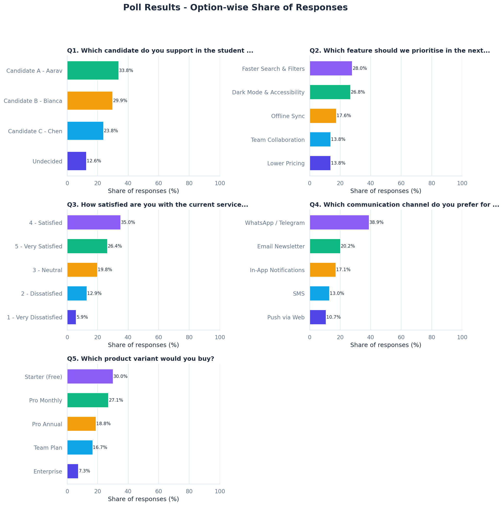 | 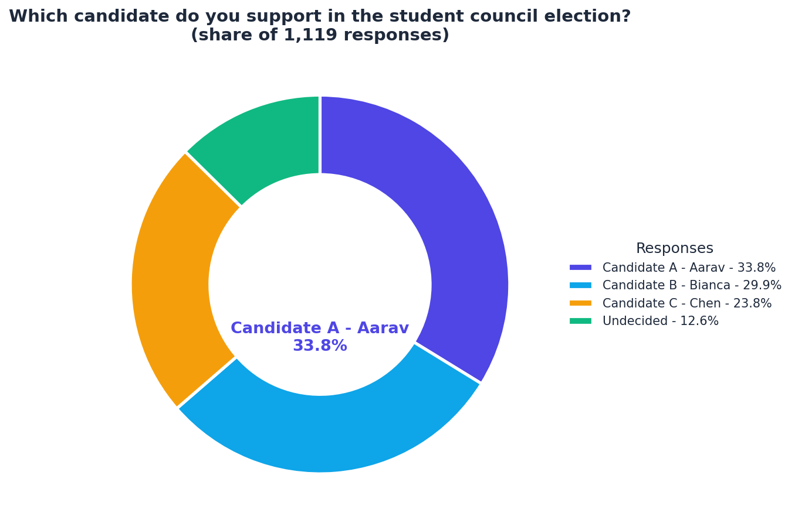 |
| **Option-wise share for all 5 questions** | **Headline split with the leader in the centre** |
| 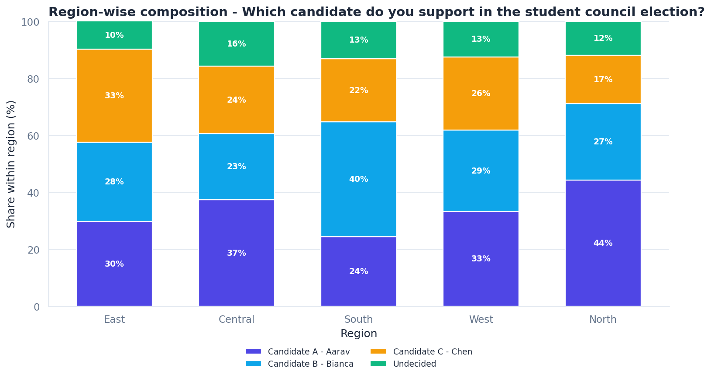 | 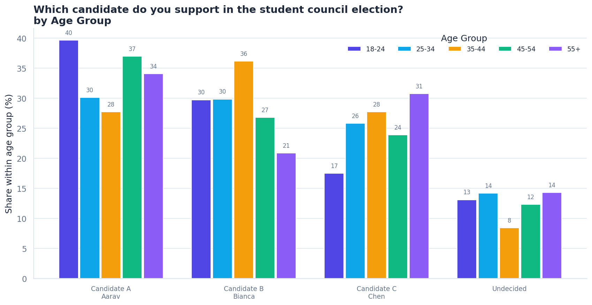 |
| **Region-wise composition** | **Age-group comparison** |
| 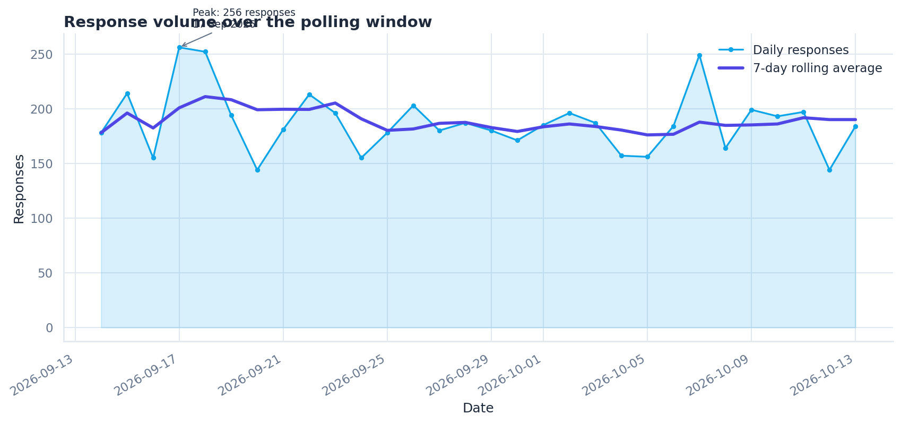 | 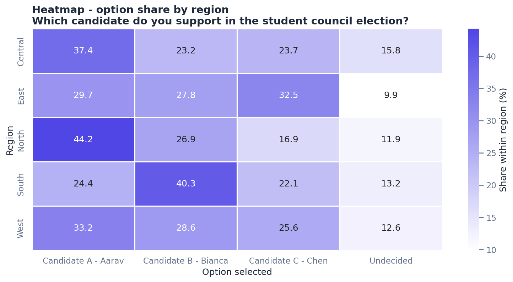 |
| **Response trend with 7-day average** | **Region × option heatmap** |
| 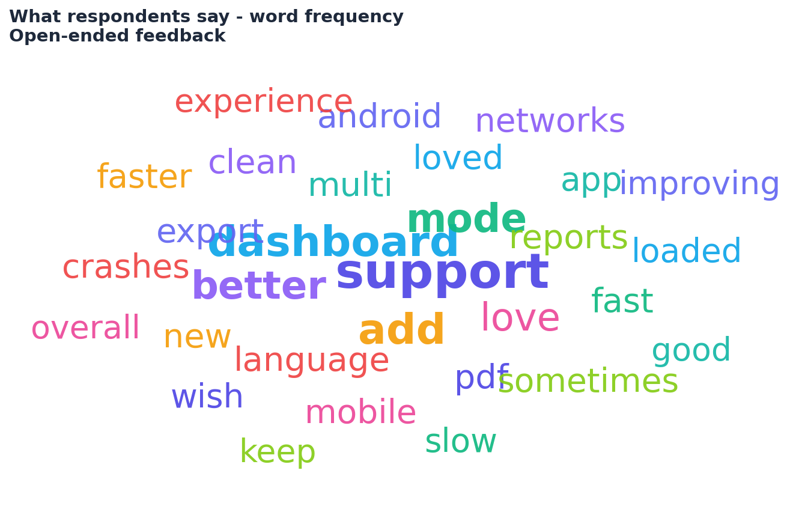 | 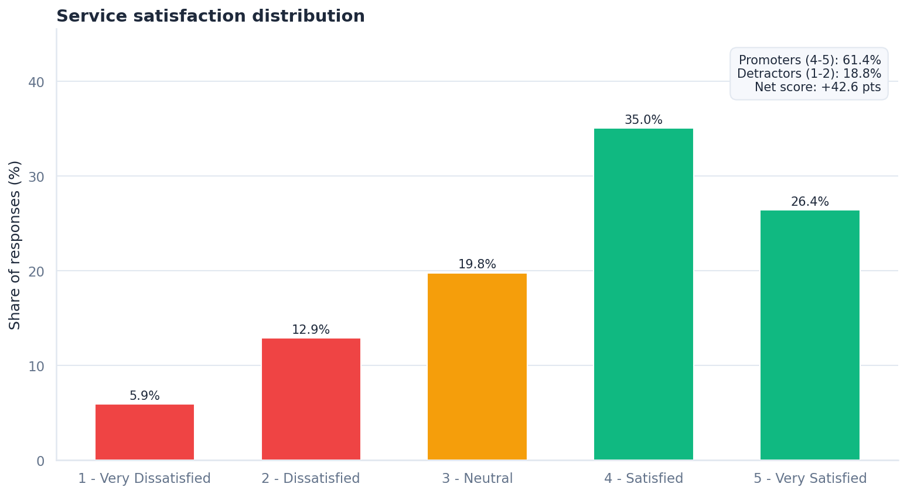 |
| **Word cloud from free-text feedback** | **Satisfaction / promoters vs detractors** |
| 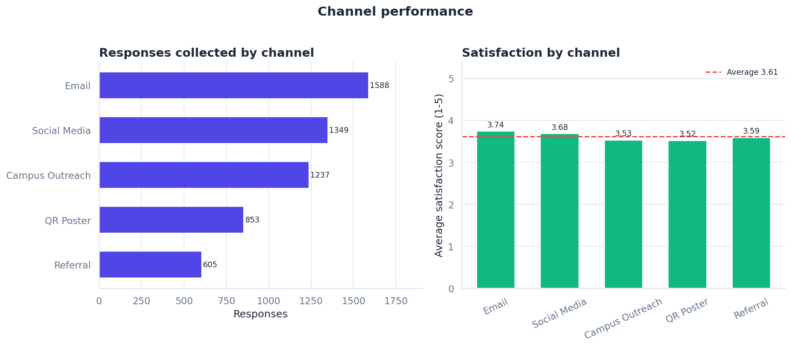 | 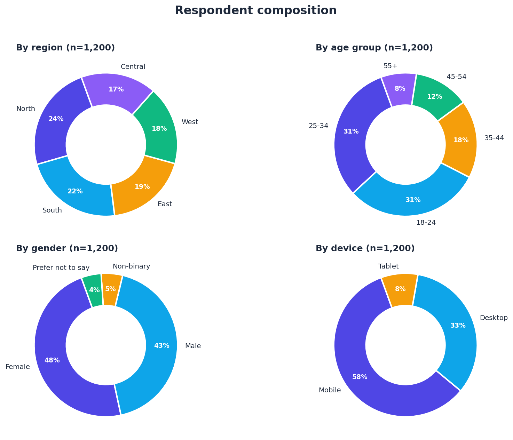 |
| **Channel performance** | **Respondent composition** |

### Dashboard

> `python main.py dashboard`

| | |
| --- | --- |
|  | KPI tiles: responses, questions, window, satisfaction, leader + MoE |
| 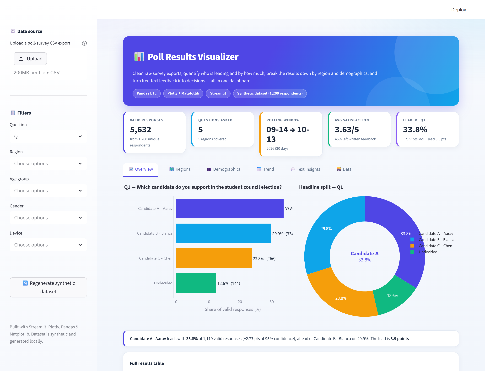 | Overview tab: option-share bars, headline donut, insight banner, results table |
| 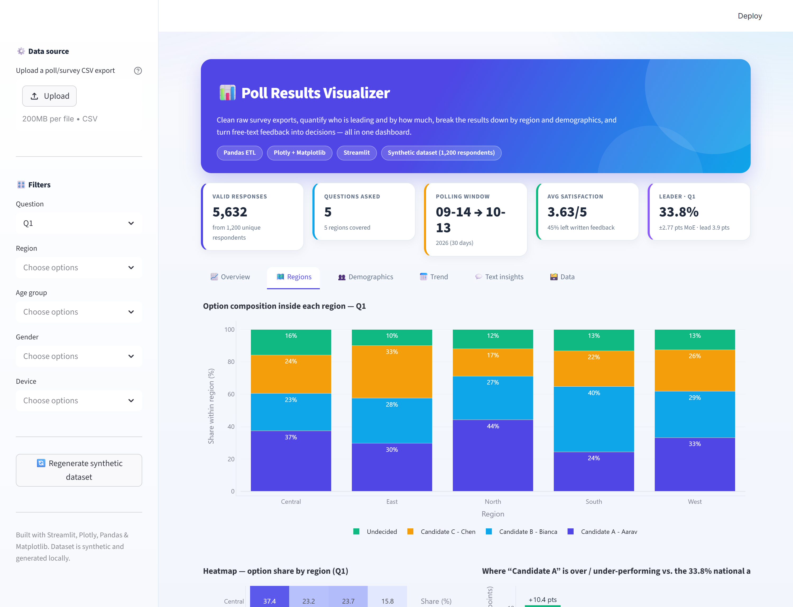 | Regions tab: stacked composition, heatmap, over/under-performance vs the national average |
| 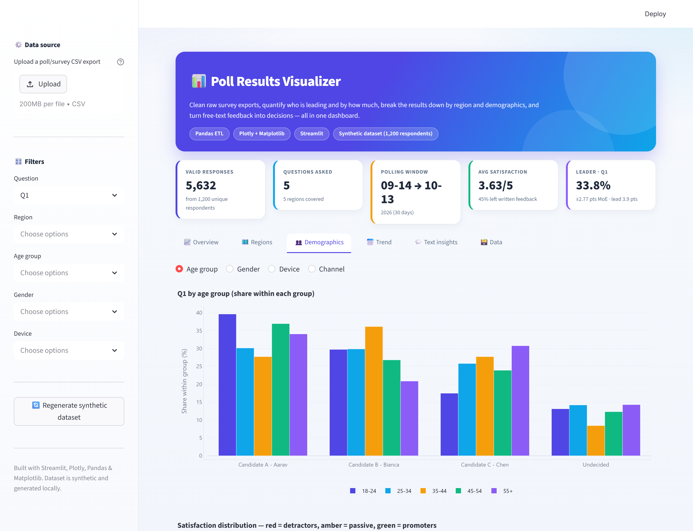 | Demographics tab: group comparison, satisfaction split, channel performance |
| 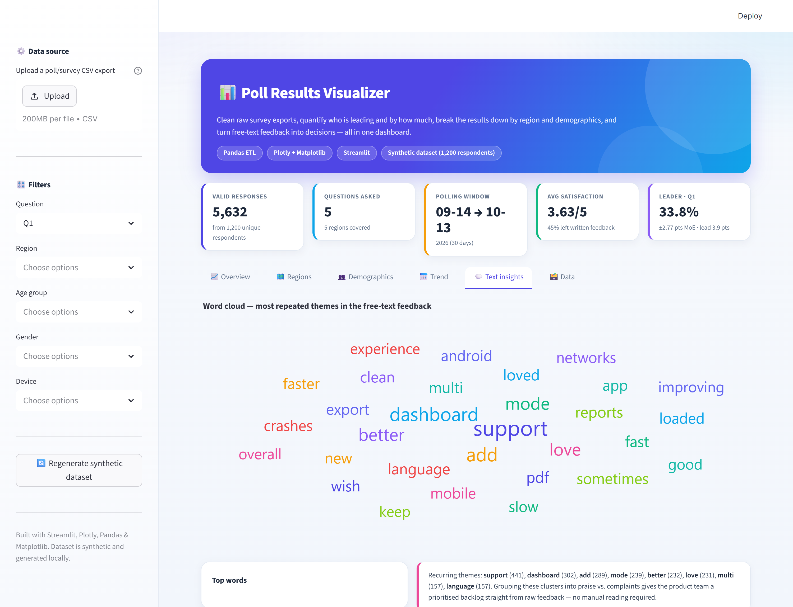 | Text insights tab: interactive word cloud, top words, raw quotes |

---

## 8. Dashboard walkthrough

| Tab | What to look for |
| --- | --- |
| **📈 Overview** | option share bars with vote counts, donut with the leader in the middle, full results table |
| **🗺️ Regions** | 100% stacked composition, heatmap, and a diverging "over/under-performing vs national average" chart |
| **👥 Demographics** | group comparison across age / gender / device / channel, plus satisfaction split and channel performance |
| **📅 Trend** | daily volume, 7-day rolling average, and the full daily table |
| **💬 Text insights** | interactive word cloud, top-word table, and a sample of raw quotes |
| **🗃️ Data** | cleaned dataset preview + **Download cleaned CSV** |

Sidebar controls: **upload your own poll CSV**, pick the active **question**, filter by region / age group / gender / device, or **regenerate the synthetic dataset with a new seed**.

---

## 9. Using your own data

The dashboard accepts any Google-Forms-style export. Required columns:

```text
respondent_id      response_date      question_id      option_selected
region (optional)  age_group (optional)  gender (optional)
device (optional)  channel (optional)   open_feedback (optional)
```

Uploading runs the **same cleaning pipeline** on it, so the only requirement is a CSV — not a clean one.

```python
# or from Python
from src import data_cleaning
clean, quality = data_cleaning.clean_poll_data(pd.read_csv("my_poll.csv"))
```

---

## 10. Virtual simulation (how the data is made)

The generator is not random noise — it builds a *population with opinions*:

1. **Sample 1,200 respondents** with realistic demographic margins (region, age, gender, device, acquisition channel) and a 45% chance of leaving written feedback.
2. **Weight each answer** per question using a base distribution *plus* demographic tilts, e.g. Candidate A gets +45% weight in the North, Candidate B +40% in the South, 18–24s favour WhatsApp 40% more than 55+.
3. **Sample the option** from the resulting normalised probability matrix (vectorised categorical sampling).
4. **Derive `satisfaction_score`** from the 1–5 scale question so numeric analysis has a real source column.
5. **Pollute it** the way a survey tool does: exact duplicates, blank answers, junk answers (`N/A`, `test`, `-`), mixed casing, padding whitespace, and 20% of dates in `dd/mm/yyyy` or `Jan 5, 2026` format.
6. **Run the pipeline on the result** — which is the point: cleaning, analysis and insights are all exercised by data with genuine structure and genuine defects.

Two bugs found and fixed *by* this simulation (see `docs/TROUBLESHOOTING.md`): writing formatted date strings into a `datetime64` column silently **erased the mixed date formats**, and `pd.to_datetime(format="mixed", dayfirst=True)` **swaps ISO dates** (`2026-10-02` → 2026-02-10).

---

## 11. Testing

```bash
python tests/test_pipeline.py    # 15 tests, no pytest required
python -m pytest tests/ -q       # if you prefer pytest
```

| Test | Asserts |
| --- | --- |
| `test_generation_shape` | row/column shape, one row per respondent per question |
| `test_generation_injects_dirt` | duplicates, blanks, mixed dates really exist in the raw file |
| `test_cleaning_removes_noise` | no duplicate / blank / padded value survives |
| `test_cleaning_removes_normalisation_duplicates` | `14/09/2026` + `candidate a - aarav` collapse to one row |
| `test_cleaning_dates_valid` | every date parses, span matches the 30-day window |
| `test_cleaning_categories_canonical` | every option belongs to its question's option set, units |
| `test_option_shares_sum_to_100` | shares per question total 100%, votes match row counts |
| `test_question_summary_stats` | ordering, ranges, MoE ≥ 0, NPS present for the scale question |
| `test_margin_of_error` | MoE shrinks as n grows; 1.96·√(p(1−p)/n) is exact |
| `test_breakdowns` | shares per group total ~100% |
| `test_trend_table` | daily volume reconciles with the row count |
| `test_word_frequencies` | stop words removed, counts sorted |
| `test_json_summary_is_serialisable` | `json.dumps` succeeds on the bundle |
| `test_charts_generated` | 10 non-empty PNGs |
| `test_insights_report` | every required section exists |
| `test_dashboard_runs` (AppTest) | the Streamlit app renders with **zero exceptions** |
| `test_dashboard_filters` (AppTest) | switching question re-renders cleanly |
| `test_browser_dashboard_end_to_end` (Playwright) | **17 real-browser checks**: every tab renders charts, question switch works, filters apply, the CSV upload path works, the download button exists, and there are **zero console/page errors** |

The browser test starts the dashboard itself, runs the checks, and tears the server down — so `python -m pytest tests/ -q` is the single command that proves the whole project works. Evidence screenshots land in `outputs/test_evidence/`.

---

## 12. GitHub upload

```bash
git branch -M main
git remote add origin https://github.com/harshaks17-ai/Poll-Results-Visualize.git
git push -u origin main
```

- **Repo:** [`harshaks17-ai/Poll-Results-Visualize`](https://github.com/harshaks17-ai/Poll-Results-Visualize)
- **Description:** `End-to-end poll/survey analysis pipeline: cleaning, statistics, charts and an interactive Streamlit dashboard (Python, Pandas, Plotly).`
- **Topics:** `python` `pandas` `data-analysis` `data-visualization` `plotly` `streamlit` `matplotlib` `seaborn` `survey-analysis` `dashboard` `eda` `data-science`

Full step-by-step guide: [`docs/GITHUB_GUIDE.md`](docs/GITHUB_GUIDE.md)

---

## 13. Documentation

| File | Contents |
| --- | --- |
| [`docs/PROJECT_GUIDE.md`](docs/PROJECT_GUIDE.md) | Project explanation (simple + technical), tech-stack options A/B/C and why B was chosen, architecture, phase-wise plan with mistakes to avoid, day-wise proof-building plan, screenshot checklist |
| [`docs/INTERVIEW_PREP.md`](docs/INTERVIEW_PREP.md) | 12 interview questions with answers, HR + technical explanation |
| [`docs/GITHUB_GUIDE.md`](docs/GITHUB_GUIDE.md) | repo creation, commit hygiene, what to screenshot |
| [`docs/TROUBLESHOOTING.md`](docs/TROUBLESHOOTING.md) | every bug found while building this, and the fix |

---

## 14. Limitations (and what they mean)

- The dataset is **synthetic**; it demonstrates the pipeline, it does not describe real voters or customers.
- Margin of error uses the **normal approximation**, which assumes a roughly random sample — a convenience sample (campus outreach) will be biased in ways a formula cannot detect.
- Share percentages are computed on **valid answers per question**, so the denominator changes slightly per question. That is correct behaviour for optional questions, but say so in any report.
- Text analysis is frequency-based, not semantic. Detecting "did the crash reports mention Android specifically" is a job for LLMs, and is listed as a future improvement.

---

## 15. Future improvements

- [ ] Streamlit share-deploy (`community Cloud`) or Docker image
- [ ] Power BI / Tableau version using the cleaned CSV
- [ ] Sentiment analysis and topic clustering on `open_feedback`
- [ ] Significance testing (chi-square) between regions instead of descriptive comparisons
- [ ] Weighting the sample to a real population (age/region) to correct sampling bias
- [ ] REST API (FastAPI) exposing the analysis endpoints
- [ ] Live polling integration: Google Sheets / Typeform webhook → auto-refresh
- [ ] Multi-poll comparison: trend the same question across several poll cycles

---

## 16. License

[MIT](LICENSE) — free to use for learning, portfolios and coursework.

---

*Built as a portfolio project: cleaning → statistics → visualisation → insights → deployment. Synthetic data, real methods.*
